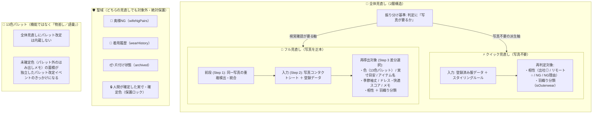

# スマートクローゼット機能地図 ＆ 全体見直し基準書 (`docs/FEATURE_MAP.md`)

本ドキュメントは、Smart Closet (`smart-closet`) において機能追加を重ねて生じた「機能の重複」「画面ごとの言葉の揺れ」「残存している受け口」を整理し、一貫性のある快適なUIへリファクタリングするための**後続フェーズすべての判断基準（単一の正本：Single Source of Truth）**である。

---

## 1. 全体見直しの設計原則（4つの基本原則）

本アプリは『朝、外出のために決める服』だけを扱い、分類は朝の判断での役割で決める。コート・靴や小物・未登録の部屋着は対象外で、未登録は漏れではなく対象外である。

画面構成・操作導線・文言・全体見直し仕様を整理・判断する際は、以下の4原則を絶対基準とする。

1. **本拠地は1つ（Single Home）**
   - すべての機能・設定・状態変更には、必ず1か所だけ「本拠地（正本となる操作場所）」を定める。
   - 他の画面に配置する「文脈ショートカット」は、その画面の文脈で即座に実行する明確な必然性があり、かつ**本拠地と同じ見た目・同じ言葉**で振る舞う場合のみ許容する（似たような別の操作UIを量産しない）。
2. **言葉は全画面で統一（Unified Vocabulary）**
   - 同じ概念・分類・状態・操作には、全タブ・全モーダル・AIプロンプトを通じて同一の言葉を使用する。
   - 画面ごとの勝手な言い換え（例: ある画面では「1枚もの」、別の画面では「シャツ」）や、旧仕様の文言（例: 「12色」「服追加・AIタブ」）を完全に排除する。
3. **頻度が低いものは段階的開示（Progressive Disclosure）**
   - 毎朝1秒で迷わず行うべき日常操作（即決・着用記録）を最前面・最小タップ数で提供する。
   - 初期設定、トラブル復旧、年数回の全体見直し、バックアップ、テスト用シミュレータ等の低頻度操作は、折りたたみ（アコーディオン）や専用モーダルウィザードの奥に整然と格納する。
4. **「覚えなくていい」（Zero Cognitive Load）**
   - 複雑な仕組み（Push/Pull の送受信順序、双方向リンク整合性、確定値の上書き保護ロック、どの見直しを実行すべきかの判定基準など）はすべてアプリ側が引き受ける。
   - ユーザーに手順や例外ルールを暗記させず、画面の案内に沿うだけで安全に操作が完結する設計を徹底する。

---

## 2. 現行全機能の棚卸しと「本拠地・線引き」一覧表

現行の全機能（4タブ＋2モーダル＋内部受け口）について、機能 × 入口 × 操作場所を棚卸しし、本拠地と線引き（存続／文脈ショートカットとして残す／統合／削除）を明確に定義する。

### 2.1 Tab 1: 朝モード (`TodayView.tsx`)
毎朝1秒でその日のコーディネートを決定するための画面。

| 機能・操作 | 現在の入口・操作場所 | 本拠地 | 線引き | 整理メモ・言葉の統一指針 |
| :--- | :--- | :--- | :--- | :--- |
| **気象連動・推奨袖丈の切替** | 左ペイン上部 `WeatherWidget`（都市切替・再取得・袖丈ピル手動切替） | 朝モード（上部） | **存続** | 朝のシャツ絞り込みの起点として現状維持。 |
| **シーン切替（オフィス出社／外出）** | 左ペイン上部 シーン切替ボタン | 朝モード（上部） | **存続** | 朝1秒即決の主軸スイッチ。「リモート」は服装の制約がなく外出側に含むため「オフィス出社」「外出」の2呼称に整理。 |
| **本日の決定コーディネート表示 ＆ 羽織り解除** | 左ペイン「本日の決定コーディネート」バナー（羽織り解除ボタン付き） | 朝モード（決定バナー） | **存続** | 当日の決定状態の即時フィードバックとして維持。 |
| **シャツ選択 ＆ 分類フィルター** | 左ペイン シャツグリッド（デフォルトおすすめ最大3着＋全部見る展開） ＋ フィルターピル（`すべて` / `👔 1枚もの` / `🧥 羽織り`）＋ 気温外シャツ折りたたみ | 朝モード（シャツ選択） | **存続** | 気温適合・シーン（推奨パンツあり・非補充）・着用履歴・鉄板ペアから上位（最大3着、1枚もの）をデフォルト表示し、「全部見る」で全件展開可能。共通フィルターピル部品（`FilterPillBar`）を使用。 |
| **空状態（シャツ0着時）の案内表示** | `shirts.length === 0` 時の案内カード | 朝モード | **存続（文言統一済）** | 「『管理』タブの『ワードローブ整理』セクションから『出す』で戻す」へ文言統一済。 |
| **羽織りの手動追加・解除（当日コーデ用）** | 右ペイン「🧥 羽織りを1着追加する（任意・手動）」アコーディオン | 朝モード（おすすめ上部） | **存続** | 羽織りは自動推薦せず手動追加のみとする原則を維持。 |
| **おすすめパンツ即決（今日これ着る）** | 右ペイン 第1〜第3候補カード ／ その他の着用可能パンツアコーディオン | 朝モード（右ペイン） | **存続** | 0秒即決の主機能。ボタン表記（「✅ 今日これ着る」とその他の「着る」）の統一余地を整理。 |
| **上下コーディネート拡大 ＆ 1着全画面スワイプ拡大** | パンツ写真タップ → 上下コーディネート詳細モーダル → 写真タップで全画面拡大（左右スワイプ切替） | 朝モード（詳細モーダル） | **存続** | NGパンツの着用ボタン（「この組み合わせを着る」）もこのモーダル内のみに置く設計を維持。共通全画面ビューア部品（`FullscreenPhotoViewer`）を使用。 |
| **奥様NGの登録・解除（朝モード側）** | おすすめ・その他カード内の「奥様NG / 🚨」ボタン、NGアコーディオン内の「奥様NGを解除」ボタン | **相性タブ（相性詳細モーダル）** | **文脈ショートカットとして残す** | 朝その場でダメ出しを受けた際の即時除外に必須のためショートカットとして存続。見た目・文言を本拠地と揃える。 |

### 2.2 Tab 2: 追加・相談 (`AiSyncView.tsx`)
新しい服の登録（1着ずつ／まとめ撮り）と、Gemini への買い足し相談プロンプト生成を行う画面。

| 機能・操作 | 現在の入口・操作場所 | 本拠地 | 線引き | 整理メモ・言葉の統一指針 |
| :--- | :--- | :--- | :--- | :--- |
| **服の新規登録 Step 1（写真選択・1着／まとめ撮り切替・A4案内・専用下書き保存）** | 追加・相談タブ Step 1 | 追加・相談タブ（Step 1） | **存続** | 通常（1着）とまとめ撮り（最大3着）のモード切替・下書き自動復元を維持。 |
| **Google ドライブ画像アップロード失敗時の再試行** | Step 1 および Step 3 に未完了バナーを表示 | 追加・相談タブ | **存続（仕様整理済）** | ドライブ送信失敗時に未完了リストを永続化し、服を二重登録することなく画像のみ再送信できるリカバリ導線として Step 1・Step 3 に常設。 |
| **服の新規登録 Step 2（1行補足メモ・手動固定・プロンプトコピー）** | 追加・相談タブ Step 2（手動固定アコーディオンは通常モードのみ） | 追加・相談タブ（Step 2） | **存続** | 13色パレット・A4基準化プロンプト生成を維持。 |
| **服の新規登録 Step 3（JSON貼り付け・確認・微修正・マージ保存）** | 追加・相談タブ Step 3（単一確認パネル ／ まとめ撮り確認パネル） | 追加・相談タブ（Step 3） | **存続（文言統一済）** | 単一確認パネル内の旧表記を「13色」に統一済。 |
| **Step 3 内の「色パレット一括更新（`colorUpdates`）」受け口** | Step 3 `jsonInput` に `colorUpdates` を貼った時のみ出現するプレビュー（プロンプト生成ボタンは既に廃止済み） | なし（旧移行用） | **削除済** | 入口が既に無く、色確定は登録時またはフル見直しで行うため、Phase 2 にて完全撤去。 |
| **Step 3 内の「羽織り分類一括更新（`outerwearUpdates`）」受け口** | Step 3 `jsonInput` に `outerwearUpdates` を貼った時に出現するプレビュー | 全体見直し（クイック見直し）へ移行 | **削除済** | 「羽織り一括相談」廃止に伴い、専用受け口も Phase 2 にて完全撤去。クイック見直し（Phase 4）の差分適用に一本化する。 |
| **🛍️ ワードローブ買い足し相談** | 追加・相談タブ 下部「💬 Gemini スタイリスト相談」セクション内カード1 | 追加・相談タブ（スタイリスト相談） | **存続** | 【ユーザー確定事項】手持ち服・相性の死角・奥様NG・着用実績を踏まえた自由対話相談として存続。 |
| **🔄 全体見直し ＆ 重複検出・統合（追加・相談タブ側入口）** | 追加・相談タブ 下部「💬 Gemini スタイリスト相談」セクション内カード2 | **管理タブ（全体見直し）** | **管理タブへ集約・削除済** | Phase 4 にて本拠地を「管理タブ」に一本化し、追加・相談タブ側の起動ボタンおよび案内表示も完全撤去。 |
| **🧥 既存シャツの羽織り分類・一括相談** | 追加・相談タブ 下部「💬 Gemini スタイリスト相談」セクション内カード3 | なし（クイック見直しへ統合済） | **削除済（統合完了）** | 【ユーザー確定事項】Phase 2 で入口・受け口を削除し、Phase 4 のクイック見直し（相性・羽織り再判定）へ役割を統合済み。個別切替（管理タブ／ギャラリー）も継続。 |

### 2.3 Tab 3: 相性 (`MatrixView.tsx`)
全アイテムの組み合わせ相性を一望し、ワードローブの死角やボトルネックを発見する画面。

| 機能・操作 | 現在の入口・操作場所 | 本拠地 | 線引き | 整理メモ・言葉の統一指針 |
| :--- | :--- | :--- | :--- | :--- |
| **第1層：ワードローブ健全性＆穴の発見ダッシュボード** | 相性タブ最上部（総組合せ・出社◎・NG数・健全率%、要注意アイテム警告カード） | 相性タブ（第1層） | **存続** | ボトルネック発見の主機能として維持。チップタップで第2層へスクロール遷移。 |
| **第2層：アイテム個別ドリルダウン（1着フォーカスビュー）** | 第1層チップまたは第3層行列ヘッダータップで展開 | 相性タブ（第2層） | **存続** | 選択した1着に対する全相手のソート一覧として維持。 |
| **第3層：全体マトリックス表 ＆ 表示フィルター** | 相性タブ下部（分類ピル ＋ 条件ピル ＋ 凡例 ＋ 行列テーブル） | 相性タブ（第3層） | **存続** | 共通フィルターピル部品（`FilterPillBar`、wrap形式）を使用し、分類（すべて／1枚もの／羽織り）と分析・季節条件（要注意／出社対応／長袖／七分袖・半袖）を分離して表示。 |
| **コーディネート相性詳細モーダル（奥様NG登録・解除）** | 第2層カードまたは第3層セルをタップして開くモーダル | **相性タブ（相性詳細モーダル）** | **存続（本拠地）** | 組み合わせ単位の相性確認および奥様NG登録・解除の唯一の本拠地。 |

### 2.4 Tab 4: 管理 (`ManageView.tsx` + 子コンポーネント)
ワードローブの整理・写真一覧・パッキング・データ保守を集約した画面。

| 機能・操作 | 現在の入口・操作場所 | 本拠地 | 線引き | 整理メモ・言葉の統一指針 |
| :--- | :--- | :--- | :--- | :--- |
| **🖼️ クローゼット写真一覧（ギャラリー）＆ 全画面スワイプビューア** | 管理タブ セクション1 (`ClosetGallerySection.tsx`) | 管理タブ（写真一覧） | **存続（本拠地）** | 服の写真閲覧・確認の本拠地。共通フィルターピル（`FilterPillBar`）および共通全画面ビューア（`FullscreenPhotoViewer`）を使用。 |
| **服を「片付ける／出す」操作** | ① 管理タブ > 写真一覧の全画面ビューア下部バー ② 管理タブ > ワードローブ整理セクション（片付けた服一覧＆片付ける服選択アコーディオン） | **管理タブ（ワードローブ整理）** | **統合・整理（本拠地＋文脈ショートカット）** | 管理タブ内に2つの整理UIが混在。一覧でまとめて操作する「ワードローブ整理」を本拠地とし、ビューア内は文脈ショートカットと位置づけ、共通ボタン部品（`ArchiveToggleButton`）を使用。 |
| **シャツの「👔 1枚もの ⇔ 🧥 羽織り」個別切替** | ① 管理タブ > 写真一覧ビューア下部バー ② 管理タブ > ワードローブ整理セクションの各シャツ行 （※新規登録時は追加・相談タブ Step 3） | **管理タブ（写真一覧ビューア / ワードローブ整理）** | **統合・整理（表記統一）** | 共通ボタン部品（`OuterwearToggleButton`）を使用し「👔 1枚ものに変更 / 🧥 羽織りに変更」へ表記を統一。 |
| **🧳 旅行パッキング (`TravelPlannerView.tsx`)** | 管理タブ セクション3（泊数・目的選択、厳選ボトムス2本＋シャツ日程表、再提案） | 管理タブ（旅行パッキング） | **存続** | 奥様NG完全回避のミニマル荷物計画として現状維持。 |
| **💾 バックアップ（JSON保存・JSONコピー）** | 管理タブ セクション4 折りたたみ内 | 管理タブ（バックアップ） | **存続** | 頻度低のため段階的開示（折りたたみ）を維持。 |
| **全体見直し（クイック見直し／フル見直し）＆ 重複検出・統合（管理タブ側入口）** | 管理タブ セクション4「🔄 全体見直し ＆ 💾 バックアップ」内の2カード | **管理タブ（全体見直し）** | **存続（本拠地・一本化完了）** | Phase 4 にて本拠地として一本化完了。「⚡ クイック見直し（写真不要・約1分）」と「📸 フル見直し ＆ 重複統合（写真を正本）」の2カード構成で常設提供。 |
| **初期データに戻す（内部受け口のみ残存）** | `SPECIFICATION.md` から記載を削除済み。`useClosetStore` / `SyncTombstones` に `clearCustomClosetData` のみ残存 | なし | **整理対象（ドキュメント不整合の解消済）** | UIにボタンが存在しない不整合を解消（GAS・同期墓標の互換性は覆さない）。 |

### 2.5 ヘッダー常設モーダル（着用履歴 ／ クラウド同期）

| 機能・操作 | 現在の入口・操作場所 | 本拠地 | 線引き | 整理メモ・言葉の統一指針 |
| :--- | :--- | :--- | :--- | :--- |
| **着用履歴の閲覧・個別削除・全クリア** | ヘッダー右「時計」アイコン → `HistoryModal.tsx` | 着用履歴モーダル | **存続（本拠地）** | 過去の記録確認と個別削除の本拠地。 |
| **冷却期間クイックテスト（昨日着用シミュレート）** | `HistoryModal.tsx` 上部に常設露出 | なし | **削除済** | Phase 2 にて完全撤去（不要な検証用シミュレート機能の廃止）。 |
| **クラウド同期状態表示 ＆ 統合「今すぐ同期」** | ヘッダー右「雲」アイコン → `GasSyncModal.tsx` 通常表示エリア（3要素） | クラウド同期モーダル | **存続（本拠地）** | 「覚えなくていい」設計原則のリファレンス実装として維持。 |
| **詳細・復旧 ／ 接続設定 ／ セットアップガイド ／ 写真キャッシュ全消去** | `GasSyncModal.tsx` 折りたたみセクション ＆ 最下部危険操作 | クラウド同期モーダル（折りたたみ） | **存続** | 段階的開示の原則どおり現状維持。 |

---

## 3. 「全体見直し」の2層化と色パレットの定義

ユーザー確定事項に基づき、全体見直し機能と色パレットの位置づけを次のように定義する。

### 3.1 「全体見直し」の2層構造
1. **⚡ クイック見直し（写真不要・軽量全体見直し）**
   - **目的:** 服の登録が増えた後や、スタイリングルールを改定した後に、いつでも手軽にワードローブ全体の相性と羽織り判定を最新化する。
   - **入力:** 写真は使わず、現在登録されている服データ（色・名前・季節袖丈・スコア・メモ）とスタイリングルールのみを入力とする。
   - **再判定対象:** **相性（出社◎・リモート○・NG・NG理由）** および **羽織り分類（`isOuterwear`）**。
   - **役割統合:** 従来の「既存シャツの羽織り分類・一括相談」は廃止され、このクイック見直しに統合される。
2. **📸 フル見直し（写真を正本・本格全体見直し）**
   - **目的:** Google ドライブ／IndexedDB に保存された写真を正本として、服の視覚的属性から相性までを丸ごと再分析・見直しする。
   - **前段の維持:** 同一写真の二重登録をハッシュ照合で検出・統合する**「重複検出・統合」はフル見直しの前段（Step 1）として維持**する。
   - **再導出対象:** 写真コンタクトシートから導出する**色（13色パレット）、実寸目安（cm）、アイテム名、季節袖丈、ドレス度・快適度スコア、メモ ＋ 相性・羽織り分類**。

### 3.2 見直し対象の振り分けルールと聖域（対象外）
- **振り分けルール:**
  今後新しい属性や派生軸が追加された場合は、**「判定に写真が要るか」**で機械的に振り分ける。
  - 写真不要で、登録済み属性とルールから導出可能な軸 → **クイック見直し（およびフル見直し双方）の対象**
  - 写真の視覚確認（生地感・シルエット・色かぶり・寸法比較等）が必要な軸 → **フル見直しのみの対象**
- **聖域（どちらの見直しでも絶対に対象外・保護するもの）:**
  人間の主観的判断および実際の生活記録に属するデータは、クイック見直し・フル見直しのどちらであっても**自動上書き・変更の対象外**とする。
  1. **🚨 奥様NG（`wifeNgPairs`）:** 奥様からのダメ出し記録は絶対に変更・解除しない。
  2. **📅 着用履歴（`wearHistory`）:** 過去の着用実績・日付は一切変更しない（重複統合時のID置換を除く）。
  3. **📦 片付け状態（`archived`）:** 片付けた服の状態は維持する。
  4. **🔒 人間が確定した実寸目安・確定色:** 人間が微修正・確定した値は保護ロックを適用し、初期選択・一括選択では適用されず、差分を確認して個別に選択した場合のみ適用できる（意図せぬ一括上書きを防止）。

### 3.3 色パレットの位置づけ（機能ではなく「物差し／語彙」）
- 13色パレットは、アプリの「機能」ではなく、奥様NG判定（上下同系色の濃紺、淡青同士の繋がり、淡色同士の膨張など）を狂いなく再現するための**「物差し（語彙）」**である。
- **全体見直しにパレット改定を内蔵しない:** 全体見直しはあくまで「既存の13色パレットという物差しを使って服を再採点する」処理であり、見直し処理の中で色パレット自体を拡張・改変してはならない。
- **改定のきっかけ:** 日常の服登録において、13色に収まらない服が「未確定色（`notes` への『色の目安：〇〇 ※13色パレット外のため未確定』の自動追記）」として蓄積し、そのはみ出しが目立ってきた時をきっかけとして、**独立した判断イベント（設計見直し）としてパレット改定を行う**。

---

## 4. 統一用語集（Glossary）

画面ごと・機能ごとに揺れていた言葉を1か所にまとめ、全画面共通の標準語彙を定義する。

| 標準用語 | 定義・仕様 | 避けるべき表記揺れ・旧表現 |
| :--- | :--- | :--- |
| **👔 1枚もの** | シャツカテゴリのうち、Tシャツ・ワイシャツ・ポロシャツ・プルオーバースウェットなど、単独またはインナーの上に着る主役トップス（`isOuterwear` が `false` または未定義）。 | 「通常シャツ」「単体シャツ」、写真一覧フィルターで1枚ものだけを指して「👔 シャツ」と呼ぶ表記 |
| **🧥 羽織り** | シャツカテゴリのうち、カーディガン・ジップアップ・パーカー・ニットジャケットなど、ベースコーデ（1枚もの＋パンツ）の上から重ね着できる服（`isOuterwear: true`）。自動推薦はされず、朝モードで任意に1着手動追加できる。 | 「アウター」「上着」 |
| **片付ける / 片付けた服** | オフシーズンや着なくなった服に `archived: true` を付け、朝モード・相性・旅行パッキングの候補から除外して休眠させる操作およびその状態。 | 「保管中」「アーカイブ」「仕舞う」「オフシーズン保管」の混在（見出し・ボタンは「片付ける」「片付けた服」を基本とする） |
| **出す** | 片付けた服（`archived: true`）を元のワードローブへ1タップで復帰させる操作（`archived: false`）。 | 「現役に復帰する（出す）」「戻す」等の長い言い換え（ボタンラベルは「出す」を基本とする） |
| **🚨 奥様NG** | 奥様から実際にダメ出しを受け、ユーザーがアプリ上で登録した組み合わせ（`wifeNgPairs`）。最優先で候補から除外され、どの全体見直しでも消えない人間の記録。 | 「妻NG」（UI上は「奥様NG」に統一） |
| **× 絶対NG（ルールNG）** | スタイリング3原則（濃紺×濃紺、淡青×ブルー、淡色×淡色、柄×柄など）に基づき、アイテムデータの `ngIds` に設定された組み合わせ。 | 単なる「NG」との混同（奥様NGと区別する場合は「絶対NG」または「ルールNG」） |
| **相性の段階（5段階）** | 組み合わせの評価段階： ・`◎ 出社推奨`（出社おすすめ かつ パンツのドレス度3.0以上） ・`○ リモート推奨`（リモートおすすめ） ・`△ 着用可`（おすすめでもNGでもない着用可能ペア） ・`🚨 奥様NG`（人間が登録した最優先除外ペア） ・`× 絶対NG`（スタイリングルール上のNGペア） | 画面ごとの独自呼称 |
| **⚠️ 昨日着用（冷却中）** | 直近記録日（昨日等）に着用したパンツに付く状態。連続着用を避けるため朝モードの推薦順位が自動的に末尾へ下がる。 | 「クールダウン」「連投制限」 |
| **全体見直し（クイック見直し ／ フル見直し）** | ワードローブ全体の整合性を見直す仕組みの総称。 ・**クイック見直し:** 写真を使わず、登録情報とルールから「相性」と「羽織り分類」を再判定する軽量見直し。 ・**フル見直し:** 保存写真を正本（コンタクトシート）に、色・実寸・名前・スコア＋相性・羽織りを丸ごと再導出する見直し。 | 「全件リビルド」「再計算」「一括相談」の乱立 |
| **重複検出・統合** | フル見直しの前段（Step 1）として、同一写真の二重登録をハッシュ照合で検出し、着用履歴の日付を変えずに残す服（survivor）へIDを統合する機能。 | 「重複解消」「マージ整理」 |
| **13色パレット（確定色 ／ 未確定色）** | 奥様NGの配色地雷を再現するための13色の共通物差し（白・生成り・ベージュ・黒・チャコール・ミディアムグレー・ライトグレー・グレージュ・濃紺・ブルー・淡青・オリーブ・ブラウン）。パレット内の色は「確定色」、登録時にパレット外でメモに目安が記録された状態は「未確定色」。 | 旧表記「12色パレット」「12色から選択」 |
| **実寸目安** | A4白用紙（210×297mm）を物差しとして推定、または人間が測定・入力した服の主要寸法（cm、シャツ4項目・パンツ4項目）。確定済みの実寸は全体見直しの初期選択・一括選択から除外されて保護される（差分確認後の個別選択時のみ適用可）。 | 「サイズ」「寸法データ」 |
| **A4用紙基準化** | 撮影時に服の隣に置かれたA4白用紙（210×297mm）を参照し、AIが照明の色かぶりを補正して13色パレット判定・実寸目安（cm）推定・服領域（cropBox）自動切り抜きを行う撮影規約。 | 「A4撮影」「用紙比較」 |

---

## 5. 構造決定事項と未決定事項の解消記録

Phase 4 において、懸案であった「全体見直しの本拠地」および「全体見直し2層化の入口構成」を検討・決定し、以下のように解消した。

### 5.1 全体見直しの本拠地：管理タブへ一本化（決定・実装済）
- **決定内容:** 全体見直しの唯一の本拠地を**「管理（`ManageView.tsx`）」タブ**に集約した。
- **理由:** 管理タブは「写真一覧」「整理（片付け）」「バックアップ」など日常ルーチン外の保守系機能が集約される画面であり、全体見直し（相性・羽織り再判定やフル再導出）の性質に最も適合するため。
- **追加・相談タブの整理:** 「追加・相談」タブは日常の「服の新規登録」「スタイリスト買い足し相談」に特化させ、全体見直しの起動ボタンおよび案内表示を完全撤去し、導線の重複を解消した。

### 5.2 全体見直しの入口見せ方：2カード構成 ＆ 安心保護バナー（決定・実装済）
- **決定内容:**
  1. **安心保護ポリシーの常時明示:** 入口上部に「🛡️ 安心保護ポリシー：着用履歴・奥様NG・片付けた服の状態は、どちらの見直しを実行しても一切消えません。」のバナーを常時明示（確定色・確定実寸も初期選択・一括選択では適用されず、差分を確認して個別に選択した場合のみ適用できる保護ロックを適用）。
  2. **段階的開示と明確な2カード構成:**
     - 「⚡ クイック見直し（写真不要・約1分）」: 2ステップ（プロンプト生成＆JSON取り込み → 差分比較＆選択適用）。対象は相性と羽織り分類のみ。
     - 「📸 フル見直し ＆ 重複統合（写真を正本）」: 3ステップ（重複統合 → 写真シート＆JSON取り込み → 差分比較＆選択適用）。写真を正本として全属性を見直し。確定色・確定実寸は初期選択・一括選択では適用されず、差分を確認して個別に選択した場合のみ適用できる。
  3. **モーダル内切替:** モーダル内部上部にも「⚡ クイック」と「📸 フル」の切替タブを常設し、ユーザーが誤って開いた場合でもその場で切り替え可能。

---

## 6. フェーズ実装順序ロードマップ

本基準書に基づき、以下の順序で安全に段階的リファクタリングを実施した。

0. **Phase 0: 全体見直しの機能地図ドキュメント新設（完了）**
   - 機能棚卸しと本拠地一覧、全体見直し4原則、統一用語集、全体見直し2層化の定義を `docs/FEATURE_MAP.md` として制定。
1. **Phase 1: 言葉の統一 ＆ フィルター定義正本化（完了）**
   - コード上の旧表記（「12色」「服追加・AIタブ」など）を用語集に沿って修正。
   - フィルター定義を `closetDomain.ts` の単一正本へ集約。
2. **Phase 2: 本拠地の整理 ＆ 死んだ受け口の完全撤去（完了）**
   - 管理タブ内の「片付ける／出す」操作UIの役割整理（一覧を本拠地、ビューア内を文脈ショートカットに位置づけ）。
   - 使われていない「色パレット一括更新受け口（`colorUpdates`）」、冷却テストシミュレータ、および廃止された羽織り一括相談受け口を削除。
3. **Phase 3: 部品の共通化（完了）**
   - 全画面写真ビューアの一本化（`FullscreenPhotoViewer.tsx`）：朝モードのペア詳細拡大と管理ギャラリービューアを単一化。
   - フィルターピル表示部品の共通化（`FilterPillBar.tsx`）：全4画面のフィルターピル表示を共通部品化。
   - 操作ボタンの共通化（`GarmentActionButtons.tsx`）：片付ける／出す（`ArchiveToggleButton`）、羽織り切替（`OuterwearToggleButton`）を共通部品化。
4. **Phase 4: 「全体見直し」の2層化 ＆ 入口の管理タブ一本化（完了）**
   - 写真不要の「⚡ クイック見直し」を新設（ロジック層 PR 1・UI導線層 PR 2）。
   - 全体見直しの本拠地を管理タブへ一本化。
   - クイックは2ステップ、フルは現行3ステップを維持し、聖域データ（奥様NG・履歴・片付け・確定値）の保護を徹底。
5. **Phase 5: 仕様書の完全同期 ＆ 地図・用語維持ルールの定着（完了）**
   - `docs/SPECIFICATION.md` を最新の `main` 実態と完全同期（陳腐化記述・旧タブ番号誤記の解消）。
   - リポジトリの `AGENTS.md` および `.github/pull_request_template.md` に全体見直し4原則・「地図と用語先行」ルール・Argon計画時ルールの組み込み。
   - `docs/FEATURE_MAP.md` の Phase 5 を完了として更新。
